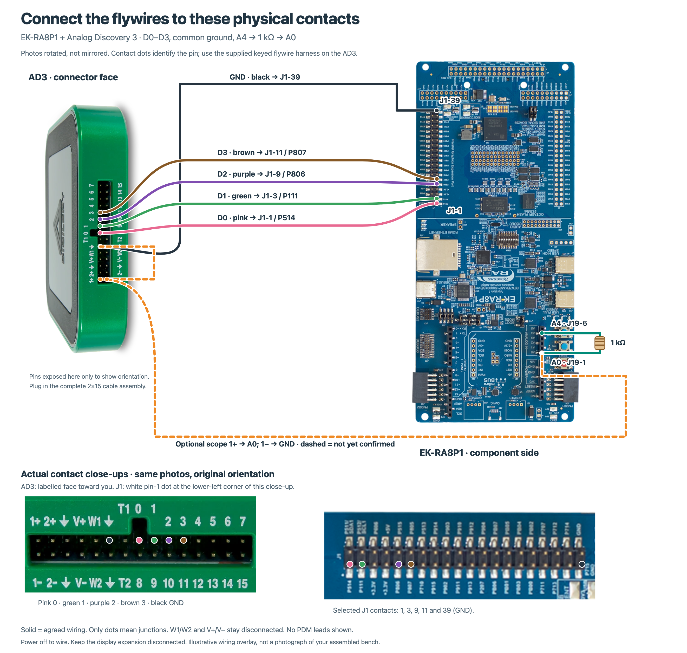

# EK-RA8P1 migration: bench wiring and validation

This document records the bench connections for testing EK-RA8P1 BSP and driver support in the **FSP 5.9.0 → 6.0.0 migration exercise**. It is a wiring reference, not a completed migration or a claim that any driver has passed validation.

This wiring guide accompanies [the migration challenge](MIGRATION.md). The preserved FSP 5.9.0 sources are in `baseline/`; this document and its diagrams are bench references, not changes to that baseline. These pin assignments are for **EK-RA8P1 v1**, not EK-RA8T2.

## Wiring diagram



[Open the HTML diagram](diagrams/ek-ra8p1-ad3-wiring.html) · [Open the SVG diagram](diagrams/ek-ra8p1-ad3-wiring.svg)

The diagram uses photographs with wiring overlays. Follow connector pin numbers and board markings; do not infer pin numbering from an image's orientation. Dashed scope leads are proposed connections, not confirmed installed wires.

## Current connections

The user confirmed these four digital destinations. They supersede the earlier proposed D2/D3 mapping.

| AD3 lead | EK-RA8P1 port | Connector contact | Status |
| --- | --- | --- | --- |
| D0 | P514 | J1-1 | User-confirmed connected |
| D1 | P111 | J1-3 | User-confirmed connected |
| D2 | P806 | J1-9 | User-confirmed connected |
| D3 | P807 | J1-11 | User-confirmed connected |
| GND | GND | J1-39 | Required common ground; confirm installed before testing |

**D0–D3 are AD3 digital channel names**, not Arduino digital pin numbers. These leads are intended as logic-analyzer inputs. The test firmware must explicitly reserve and configure the corresponding MCU pins as timing/status outputs; connecting the leads does not configure those pins. Exact marker roles remain to be defined by the test firmware.

### Confirmed analog loopback

The user confirmed one loopback with a **1 kΩ series resistor**:

```text
EK J19-5: A4 / P014 / DAC0 ─── 1 kΩ ─── EK J19-1: A0 / P001 / AN001
                                              │
                                              └── AD3 1+ (optional; not confirmed)

EK GND ─────────────────────────────────────────── AD3 1− (optional; not confirmed)
EK J1-39: GND ──────────────────────────────────── AD3 GND (required)
```

A4 and A0 are two different MCU pins. Firmware uses A4 as a DAC output and A0 as an ADC input; it does not convert the DAC pin into an ADC pin. Keep A0 configured as an analog input, never a competing output, while the loopback is fitted.

One loopback is sufficient for an initial DAC0/ADC functional test. A second DAC-to-ADC loopback is not required for this setup, and DAC1 or other ADC channels are not covered by it.

### Optional scope probes — not confirmed installed

| AD3 lead | Connect to | Purpose |
| --- | --- | --- |
| Scope 1+ | J19-1 / A0, on the ADC side of the resistor | Independently observe the loopback voltage |
| Scope 1− | Board GND | Scope channel 1 reference |

The D0–D3 leads cannot measure analog voltage. Without the scope pair, firmware can compare ADC readings with DAC commands, but that is not an independent voltage measurement. Even with the scope connected, a functional loopback test is not full ADC/DAC accuracy qualification.

## Safe setup

1. Power off the EK before changing wires, switches or jumpers. Confirm the board is EK-RA8P1 v1 and locate pin 1 using its markings.
2. Leave the parallel display expansion disconnected from J1. Its signals share the pins used here.
3. Confirm AD3 GND and EK GND are connected before taking measurements. The scope negative lead is not a replacement for the documented common-ground connection.
4. Power the EK through its normal supported USB/debug connection and connect the AD3 to the host by USB. Do not power the EK from the AD3 supplies for this setup.
5. Keep AD3 **W1, W2, V+ and V− physically disconnected**. Leave Patterns, Static I/O outputs and other signal-driving functions disabled. Use D0–D3 as inputs only.
6. Before analog tests, verify the board's routing/switch configuration, analog references and permitted input range. The EK manual documents Arduino/Octo-SPI sharing and SW4-4; resolve the affected routing before testing rather than assuming all header pins are connected by default.
7. Configure A0 as an analog input and A4 as the intended DAC output before enabling the DAC. Begin with slow, settled levels within the permitted ADC input range. The 1 kΩ resistor does not make an out-of-range voltage safe.

No physical continuity, jumper state or voltage level has been verified merely by documenting these connections.

## What this harness can test

| Driver area | Evidence available with current wiring | Additional work or limitations |
| --- | --- | --- |
| BSP/startup | Firmware can emit boot and progress markers on the reserved GPIOs | Define marker behavior and verify actual boot, pin configuration and reset cause; a marker alone does not validate every BSP feature |
| `r_mram` | Firmware can run read/write/retention checks and report results through the debugger or test logs | Reserve an explicitly safe scratch region outside code, live data and option/security areas; retention across power loss needs a controlled power cycle |
| `r_dac_b` | DAC0 can drive the A4 → A0 loopback | Add the scope pair for independent voltage/waveform observation; other channels and modes remain untested |
| ADC support (`r_adc` in the requested scope) | Firmware can sample the DAC-driven A0 input | Identify the actual ADC peripheral/driver for the target during implementation; add the scope pair for a measured voltage reference |
| `r_wdt` | GPIO markers can show activity, a deliberate refresh stop, and a subsequent boot | Verify reset cause and elapsed timeout while running freely; debugger halt/freeze behavior can change watchdog results |
| `r_cgc` | A firmware-timed GPIO can provide an observable timing signal | Define and justify the relationship to the clock under test; a heartbeat alone does not prove all clock sources, PLLs or switching modes |
| `r_pdm` | Firmware may acquire data from the on-board microphones | Current D0–D3 wiring does **not** probe PDM clock/data; use the optional probes below for direct bus observation and an acoustic stimulus to assess captured samples |

The harness supports focused functional tests, not every peripheral, channel, operating mode, electrical limit or full FSP release qualification. Build success, a successful flash and visible GPIO activity are separate evidence from a working driver.

## Optional PDM probes — not part of the current wiring

Keep D0–D3 where they are. To observe the on-board microphones directly, additional **input-only** AD3 channels can probe:

| Proposed AD3 lead | Board signal | Purpose |
| --- | --- | --- |
| D4 | P812 | Microphone clock |
| D5 | P502 | Microphone data |

Locate these signals using the board's labelled native-access pads and the matching board documentation before connecting. No connector pin number is asserted here. These probes have not been confirmed installed. Check for a valid clock/data stream and correlate the acquired PCM samples with a known acoustic tone; digital activity alone does not prove correct audio conversion.

## Validation record for the migration session

For each test, record the firmware revision, selected target/core, generated configuration, pin/routing setup, stimulus, expected result, observed result and capture/log location. Mark checks **not run**, **passed**, **failed** or **blocked**; do not infer a pass from wiring being present.

Before hardware testing:

- Confirm the exact EK-RA8P1 target and debugger configuration. Do not use an RA8T2 SVD as a register reference for RA8P1.
- Build and generate test projects using the locally modified FSP sources and metadata, not an installed stock package.
- Obtain authorization before replacing firmware. Do not modify OTP, protection or security settings as part of ordinary driver tests.
- Preserve older-device behavior with relevant regression checks in addition to the EK-RA8P1 tests.

## Sources

- [Renesas EK-RA8P1 v1 User's Manual](https://www.renesas.com/en/document/mat/ek-ra8p1-v1-users-manual): Table 20 (Arduino connector), Table 33 (J1 parallel graphics connector), and the SPH069 PDM microphone section.
- [Digilent Analog Discovery 3 getting started and hardware information](https://files.digilent.com/manuals/WaveForms/3.25.1/start10.html).

Connection status comes from the user's reported wiring, not a live instrument measurement. No hardware tests were performed as part of this documentation update.
